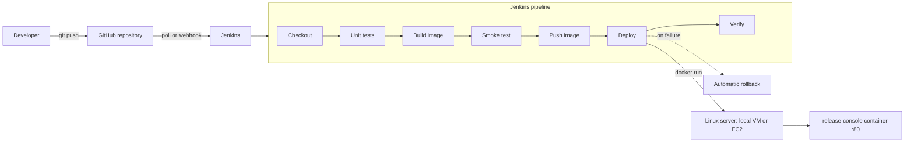

# Release Console: CI/CD Pipeline for a Web Application

An end-to-end DevOps project. A commit pushed to GitHub is tested, packaged as a
Docker image, deployed to a Linux server by Jenkins, verified, and rolled back
automatically if the new version does not come up healthy.

The web application deployed by the pipeline is itself a window into the pipeline:
it shows the build number, commit and deployment history of the container that is
serving the page, so every deployment can be seen, not just claimed.

| | |
|---|---|
| Domain | DevOps / Cloud |
| Level | Intermediate |
| Tools | Git, GitHub, Docker, Jenkins, Linux (Ubuntu 24.04), AWS EC2 or a local VM |
| Application | Node.js 20, no runtime dependencies |

## Architecture



## What the pipeline does

| Stage | What happens | What stops the pipeline |
|---|---|---|
| Checkout | Fetches the exact commit, records short SHA and branch | Repository or credentials problem |
| Validate tooling | Confirms Docker works, syntax-checks every shell script | Broken script or Docker not reachable |
| Unit tests | Lint and 10 unit tests run in a clean Node container | Any failing test |
| Build image | Production image tagged with the build number, commit, branch and time | Dockerfile error |
| Smoke test | Starts the new image on a throwaway port and calls `/health` and `/api/info` | Image builds but does not start |
| Push image | Optional. Publishes to Docker Hub (needed for EC2) | Registry login or network failure |
| Deploy | Swaps the running container, waits for its health check | Unhealthy container triggers rollback |
| Verify | Calls the live port and confirms it reports this build number | Wrong or missing build |

Full detail is in [docs/CICD-WORKFLOW.md](docs/CICD-WORKFLOW.md).

## Repository layout

```
.
├── app/                    Web application
│   ├── server.js             HTTP server, health, info, metrics, deployments API
│   ├── public/               Console page (HTML, CSS, JS)
│   └── test/                 Unit tests (node:test)
├── scripts/
│   ├── setup-ubuntu.sh       Installs Docker, Java, Jenkins on a fresh Ubuntu host
│   ├── deploy.sh             Container swap with health wait and automatic rollback
│   ├── smoke-test.sh         Pre-deploy check of the built image
│   ├── verify.sh             Post-deploy check against the live port
│   └── status.sh             One-screen monitoring view
├── docs/
│   ├── SETUP-GUIDE.md        Step-by-step environment setup (VMware and EC2)
│   ├── CICD-WORKFLOW.md      How the pipeline works, stage by stage
│   ├── GIT-WORKFLOW.md       Branching and commit conventions
│   ├── DEMO-SCRIPT.md        How to demonstrate success, test failure and rollback
│   ├── TROUBLESHOOTING.md    Symptoms, causes and fixes
│   └── presentation/         Presentation source and generator
├── Dockerfile              Multi-stage: base, test, production
├── Jenkinsfile             Declarative pipeline
└── docker-compose.yml      Local development run (not used by the pipeline)
```

## Try the application locally

```bash
cd app
npm test            # 10 unit tests
npm start           # http://localhost:3000
```

Or with Docker:

```bash
docker compose up --build     # http://localhost:3000
```

## Set up the pipeline

Follow [docs/SETUP-GUIDE.md](docs/SETUP-GUIDE.md). In short:

1. Create a GitHub repository and push this project.
2. On an Ubuntu 24.04 machine run `sudo bash scripts/setup-ubuntu.sh`.
3. Open Jenkins on port 8080, install the suggested plugins, create a Pipeline job
   that uses "Pipeline script from SCM" pointing at your repository.
4. Run the job. Open `http://<server>/` to see the deployed build.

## Design decisions

- **Tests run inside the Docker build.** The `test` stage of the Dockerfile is part of
  the production build, so an image cannot exist without its tests having passed.
- **The previous container is kept until the new one is healthy.** That is what makes
  rollback a rename, not a rebuild.
- **Health is judged by the container's own `HEALTHCHECK`,** not by whether the process started.
- **Deployments are recorded by the deploy script,** not by the application, so the
  history survives container replacement and also records failures and rollbacks.
- **Zero runtime dependencies** keeps builds fast and removes a class of supply-chain risk.
- **The container runs as a non-root user** with a 256 MB memory cap and rotated logs.
