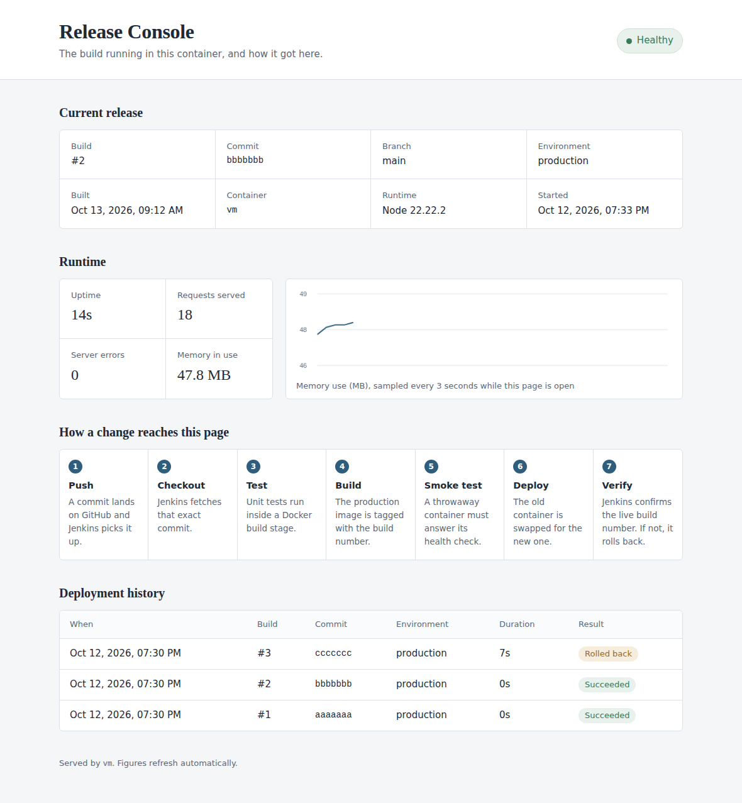
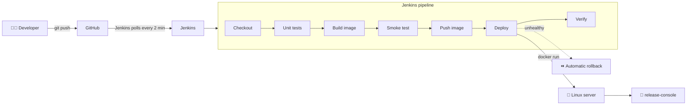
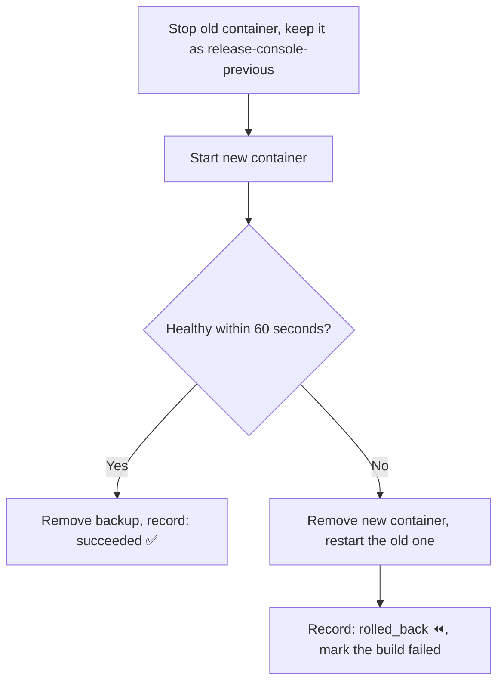

<div align="center">

# 🚀 Automated CI/CD Pipeline

### Push. Test. Ship. Verify. Rewind if needed.

**Push code to GitHub and walk away. Jenkins tests it, packs it in Docker, deploys it to a Linux server, checks it works, and rolls back by itself if it doesn't.**

<br>


<br>



<sub>The Release Console: it shows which build is live, how healthy it is, and every deployment ever made.</sub>

</div>

<br>

## ✨ At a glance

| | |
|---|---|
| 🔁 **8** | pipeline stages, from checkout to live verification |
| 🧪 **10** | automated tests that block broken code |
| 🛡️ **3** | safety nets: tests, smoke test, health check with rollback |
| 📦 **0** | runtime dependencies, so builds stay fast and small |
| 🖐️ **0** | manual steps after `git push` |

## 🎯 Why this project

Releasing software by hand is slow and easy to get wrong. Someone has to run the tests, build the package, copy it to a server, restart it, and hope nothing breaks. Afterwards, nobody can say for sure which version is running.

| 😓 Manual release | 😎 This project |
|---|---|
| Copy files to the server by hand | Jenkins deploys automatically |
| Tests are easy to forget | Tests run on every change and block bad code |
| A broken release means downtime | The previous version is restored automatically |
| Unclear which version is live | The Release Console shows build, commit and history |

## 🧩 What you get

- 🔄 **Hands-free deployment.** Every push to `main` is built, tested and deployed.
- 🧪 **Tests that gate the build.** The Docker image cannot exist unless its tests passed.
- 🔥 **Smoke test before release.** The new image must start and answer its health check first.
- ⏪ **Automatic rollback.** An unhealthy release is replaced by the last good one, and the attempt is logged.
- 📊 **A live Release Console.** Build number, commit, health, memory chart and deployment history in one page.
- 📝 **Deployment records.** Every success, rollback and failure is written to a log the page displays.
- 🔒 **Safer containers.** Non-root user, 256 MB memory cap, rotated logs and health checks.
- ☁️ **Local or cloud.** Deploy to the Jenkins machine, or to AWS EC2 over SSH.

## 🛠️ How it works



| # | Stage | What happens | Stops the pipeline when |
|---|---|---|---|
| 1 | 📥 **Checkout** | Fetches the exact commit, records its short SHA and branch | Repository or access problem |
| 2 | ✅ **Validate tooling** | Confirms Docker works and syntax-checks every shell script | A script is broken |
| 3 | 🧪 **Unit tests** | Lint and 10 tests run in a clean Node container | Any test fails |
| 4 | 📦 **Build image** | Builds the production image tagged with the build number | Dockerfile error |
| 5 | 🔥 **Smoke test** | Starts the image on a throwaway port, calls `/health` and `/api/info` | The image won't start |
| 6 | ☁️ **Push image** | Optional. Publishes to Docker Hub (needed for EC2) | Registry login fails |
| 7 | 🚢 **Deploy** | Swaps the container and waits for its health check | Unhealthy, so it rolls back |
| 8 | 🔎 **Verify** | Confirms the live port reports this exact build number | Wrong or missing build |

## ⏪ Rollback in action

The old container is never deleted until the new one proves itself.



## 🚀 Quick start

### 💻 Try the app on your own machine

Needs Node.js 20 or newer.

```bash
cd app
npm test         # 10 unit tests
npm start        # http://localhost:3000
```

Or with Docker:

```bash
docker compose up --build     # http://localhost:3000
```

### 🏗️ Build the full pipeline

Recommended server: **4 GB RAM, 2 CPUs, 30 GB disk** (a VMware VM works well).

<details>
<summary><b>Step 1: Install Java, Git, Docker and Jenkins on RHEL 10</b></summary>

<br>

```bash
sudo dnf update -y
sudo dnf install -y git curl fontconfig java-21-openjdk dnf-plugins-core

# Docker
sudo dnf config-manager --add-repo https://download.docker.com/linux/rhel/docker-ce.repo
sudo dnf install -y docker-ce docker-ce-cli containerd.io
sudo systemctl enable --now docker

# Jenkins
sudo wget -O /etc/yum.repos.d/jenkins.repo https://pkg.jenkins.io/rpm-stable/jenkins.repo
sudo dnf install -y jenkins
```

If `dnf` reports a signature or key error, import the current Jenkins key from the Jenkins Linux installation page and retry. On Ubuntu 24.04, `sudo bash scripts/setup-ubuntu.sh` does all of this for you.

</details>

<details>
<summary><b>Step 2: Let Jenkins use Docker and create the deploy folder</b></summary>

<br>

```bash
sudo usermod -aG docker jenkins
sudo usermod -aG docker $USER
sudo mkdir -p /opt/release-console
sudo chown jenkins:$USER /opt/release-console
sudo chmod 775 /opt/release-console
sudo systemctl enable --now jenkins
```

Log out and back in, then check with `docker run --rm hello-world`.

</details>

<details>
<summary><b>Step 3: Open the firewall</b></summary>

<br>

```bash
sudo firewall-cmd --permanent --add-port=8080/tcp --add-port=80/tcp
sudo firewall-cmd --reload
```

</details>

<details>
<summary><b>Step 4: Unlock Jenkins</b></summary>

<br>

1. Find the server address with `hostname -I`.
2. Open `http://<server-ip>:8080` in a browser.
3. Unlock with `sudo cat /var/lib/jenkins/secrets/initialAdminPassword`.
4. Choose **Install suggested plugins** and create your admin user.

</details>

<details>
<summary><b>Step 5: Create the pipeline job</b></summary>

<br>

1. **New Item**, name it `release-console`, choose **Pipeline**.
2. Under **Pipeline**, set **Definition** to *Pipeline script from SCM*.
3. **SCM:** Git. **Repository URL:** this repository's URL.
4. **Branch Specifier:** `*/main`. **Script Path:** `Jenkinsfile`.
5. **Save**.

</details>

<details open>
<summary><b>Step 6: Run your first deployment</b></summary>

<br>

1. Click **Build Now**. The first run lets Jenkins read the pipeline's parameters, so it may stop early. That is normal.
2. Click **Build with Parameters**, keep the defaults (`DEPLOY_TARGET` = `local`), and click **Build**.
3. Open **Stages** and watch each box turn green. The first run is slower while Docker downloads the base image.
4. Open `http://<server-ip>/` to see your Release Console. 🎉

> **Port 80 already in use?** If another site (for example nginx) uses port 80, change `HOST_PORT` in the `Jenkinsfile` (for example to `8081`), open that port in the firewall, and rebuild. The console is then at `http://<server-ip>:8081/`.

</details>

<details>
<summary><b>⚙️ Pipeline parameters and server settings</b></summary>

<br>

| Parameter | Default | Meaning |
|---|---|---|
| `DEPLOY_TARGET` | `local` | `local` deploys on the Jenkins machine. `ec2` deploys to a remote server over SSH. |
| `EC2_HOST`, `EC2_USER` | empty, `ubuntu` | Address and SSH user of the remote server (EC2 only) |
| `PUSH_IMAGE` | off | Push the image to Docker Hub. Required for EC2. |
| `REGISTRY_REPO` | empty | Docker Hub repository, for example `yourname/release-console` |
| `APP_ENV` | `production` | Value of `APP_ENV` inside the container |

To add or override environment variables on the server, create `/opt/release-console/app.env`. `deploy.sh` passes it to the container on every deployment. Keep secrets out of Git.

</details>

## 🎬 Live demo

**Make a change and watch it go live by itself:**

1. 👀 Open the Release Console and note the **Build** number.
2. ✏️ On GitHub, edit `app/public/index.html`. Change the text in the line containing `class="lede"`, then commit.
3. ▶️ In Jenkins, click **Build with Parameters**, then **Build**. (Jenkins also notices the push on its own within 2 minutes.)
4. 🟢 Watch the stages turn green, then refresh the page. The build number goes up, your new text appears, and **Deployment history** gets a new row.

**Rehearse a rollback:**

```bash
echo 'SIMULATE_STARTUP_FAILURE=true' >> /opt/release-console/app.env
```

Run a build. The smoke test passes because it runs without the server's `app.env`. The real deployment loads it, the container exits, and the pipeline restores the previous version. The history shows a **Rolled back** row. Clean up afterwards:

```bash
sed -i '/SIMULATE_STARTUP_FAILURE/d' /opt/release-console/app.env
```

A break-the-tests demo and a printable script are in [docs/DEMO-SCRIPT.md](docs/DEMO-SCRIPT.md).

## 📡 Application endpoints

| Endpoint | Returns |
|---|---|
| `/` | The Release Console page |
| `/health` | `{"status":"ok"}`, used by Docker's health check |
| `/api/info` | Build number, commit, branch, environment, hostname, start time |
| `/api/metrics` | Uptime, request count, errors, memory use, load average |
| `/api/deployments` | The 10 most recent deployments, newest first |

Every deployment appends one line to `/opt/release-console/deployments.log`:

```json
{"time":"2026-10-13T09:12:04Z","build":"7","commit":"3fa91c2","image":"release-console:7","environment":"production","durationSeconds":14,"status":"succeeded"}
```

`status` is `succeeded`, `rolled_back` or `failed`.

## 🔭 Monitoring and logs

| I want to... | Command |
|---|---|
| See everything at once | `bash scripts/status.sh` |
| Watch live logs | `docker logs -f release-console` |
| Check container health | `docker inspect -f '{{.State.Health.Status}}' release-console` |
| See CPU and memory | `docker stats release-console` |
| Ask the app if it's alive | `curl -s localhost/health` |
| Review pipeline history | Jenkins job page: **Stages** and **Console Output** |

## 🩺 Troubleshooting

| Symptom | Fix |
|---|---|
| 🔒 `permission denied` for Docker in a Jenkins build | `sudo usermod -aG docker jenkins`, then `sudo systemctl restart jenkins` |
| ⏪ Deploy ends with "Rolling back" | Read the log lines above it, or run `docker logs release-console` |
| 🌐 Page won't open from another computer | Open ports 80 and 8080 in the firewall; use a bridged VM network |
| 🚧 Port 80 already in use | Check with `sudo ss -ltnp 'sport = :80'`, or change `HOST_PORT` in the `Jenkinsfile` |
| 📭 Deployment history is empty | Run one build first; check `ls -l /opt/release-console/deployments.log` |
| ❓ `Jenkinsfile not found` | Check the job's branch (`*/main`) and that the file is in the repository root |

More in [docs/TROUBLESHOOTING.md](docs/TROUBLESHOOTING.md).

## 🧠 Design decisions

- **Tests run inside the Docker build.** An image cannot exist unless its tests passed.
- **The previous container is kept until the new one is healthy.** Rollback is a rename, not a rebuild.
- **Health comes from the container's `HEALTHCHECK`,** not from whether the process started.
- **The deploy script writes the history,** so failures and rollbacks are recorded and survive container replacement.
- **No runtime dependencies** keeps builds fast and removes a class of supply-chain risk.

## ⚠️ Limitations

- There is a gap of a few seconds while the old container stops and the new one becomes healthy. Removing it needs two instances behind a load balancer.
- The `jenkins` user is in the `docker` group, which is effectively root on that machine. That suits a lab; production would use a dedicated build agent.
- Jenkins polls GitHub every 2 minutes because a local VM cannot receive webhooks. A public server can use a GitHub webhook instead.
- AWS EC2 deployment is built into the `Jenkinsfile` (`DEPLOY_TARGET=ec2`), but the walkthrough above runs on a local VM.

## 🗺️ Roadmap

- [x] Automated build, test and deploy with Jenkins
- [x] Smoke test, health check and automatic rollback
- [x] Live Release Console with deployment history
- [ ] GitHub webhook trigger for instant builds on a public server
- [ ] Image vulnerability scanning in the pipeline
- [ ] Chat or email notifications on success and failure
- [ ] Kubernetes deployment target
- [ ] Prometheus and Grafana dashboards

## 🎓 Skills this project covers


CI/CD design, containerization, deployment automation, health checks, rollback strategy and troubleshooting.

## 📁 Repository layout

```
.
├── app/                    🌐 Web application
│   ├── server.js             HTTP server and API
│   ├── public/               Release Console page (HTML, CSS, JS)
│   └── test/                 Unit tests (node:test)
├── scripts/                🔧 Automation
│   ├── setup-ubuntu.sh       Installs Docker, Java and Jenkins on Ubuntu 24.04
│   ├── deploy.sh             Container swap with health wait and rollback
│   ├── smoke-test.sh         Pre-deploy check of the built image
│   ├── verify.sh             Post-deploy check against the live port
│   └── status.sh             One-screen monitoring view
├── docs/                   📚 Guides, demo script, troubleshooting, presentation
├── Dockerfile              🐳 Multi-stage: base, test, production
├── Jenkinsfile             ⚙️ Declarative pipeline
└── docker-compose.yml      🧪 Local run for development (not used by Jenkins)
```

<div align="center">

<br>

**Built by [Devashish Gosavi](https://github.com/gosavidevashish)**

If this project helped you learn CI/CD, a ⭐ on the repo is always appreciated.

</div>
