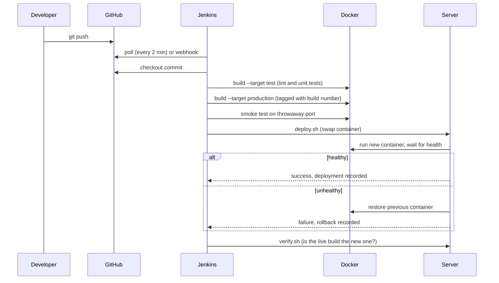

# CI/CD Workflow

This describes what happens between `git push` and a new version serving traffic.

## Sequence



## Stage reference

### Checkout
Jenkins runs `checkout scm` and records the full and short commit SHA, the branch
and a UTC timestamp. The build in Jenkins is renamed to `#<number> <short-sha>` so
a build can be matched to a commit at a glance.

### Validate tooling
Confirms the Docker daemon is reachable and runs `bash -n` on every script, so a
typo in `deploy.sh` fails here rather than during a deployment.

### Unit tests
`docker build --target test` runs `npm run lint` and `npm test` inside a clean
`node:20-alpine` container. The build fails on a non-zero exit code, which stops
the pipeline before any image is produced.

### Build image
Builds the `production` target. The build number, commit, branch and time are
passed as build arguments and baked into the image as environment variables and
OCI labels. The same image is therefore self-describing wherever it runs. A line
in the Dockerfile copies a file from the `test` stage so the tests are never skipped.

### Smoke test
`scripts/smoke-test.sh` starts the image on port 18080, polls `/health` for up to
20 seconds, then checks `/api/info` reports the expected build number. The
container is always removed, even on failure.

### Push image (optional)
Runs when `PUSH_IMAGE` is ticked. Logs in with the `dockerhub-creds` credential
using `--password-stdin` so the token never appears in the build log, pushes the
build-number tag and `latest`, and logs out. Required for EC2, because the remote
server pulls the image from the registry.

### Deploy
`scripts/deploy.sh` runs on the target (locally, or over SSH for EC2):

1. Verify the image exists locally, otherwise `docker pull`.
2. Stop the current container and rename it `release-console-previous`.
3. Start the new container with the environment variables, a 256 MB memory limit,
   rotated JSON logs and a restart policy.
4. Poll Docker's health status every 2 seconds, up to 60 seconds.
5. Healthy: remove the backup and record `succeeded`.
6. Not healthy: print the container's last 20 log lines, remove it, rename the
   backup back, start it, record `rolled_back`, and exit non-zero so Jenkins marks
   the build failed.

There is a brief gap (a few seconds) between stopping the old container and the new
one becoming healthy. A load balancer with two instances would remove it; that is
out of scope for this project.

### Verify live service
`scripts/verify.sh` calls the real public port and checks `/api/info` reports the
build that was just deployed. This catches a deploy that "succeeded" but left an
old container serving.

## Deployment record

Every deploy appends one JSON line to `/opt/release-console/deployments.log`:

```json
{"time":"2026-10-13T09:12:04Z","build":"7","commit":"3fa91c2","image":"release-console:7","environment":"production","durationSeconds":14,"status":"succeeded"}
```

The container mounts this file read-only, and the **Deployment history** table on
the page reads it. Status values: `succeeded`, `rolled_back`, `failed`.

## Monitoring and logs

| Need | Command |
|---|---|
| Overall picture | `bash scripts/status.sh` |
| Live application logs | `docker logs -f release-console` |
| Container health | `docker inspect -f '{{.State.Health.Status}}' release-console` |
| CPU and memory | `docker stats release-console` |
| Pipeline history | Jenkins job page, **Stage View** and **Console Output** |
| In the browser | `/health`, `/api/metrics`, and the Release Console page |

The application writes one JSON object per line to stdout (request method, path,
status, duration), which `docker logs` captures and Docker rotates at 5 MB x 3 files.

## Security notes

- The container runs as the unprivileged `node` user.
- Credentials are held in Jenkins, bound only to the stages that need them.
- The `jenkins` user is in the `docker` group, which is effectively root on that host.
  Acceptable for a lab; in production use a dedicated build agent.
- Port 8080 and SSH should be reachable only from trusted addresses.
